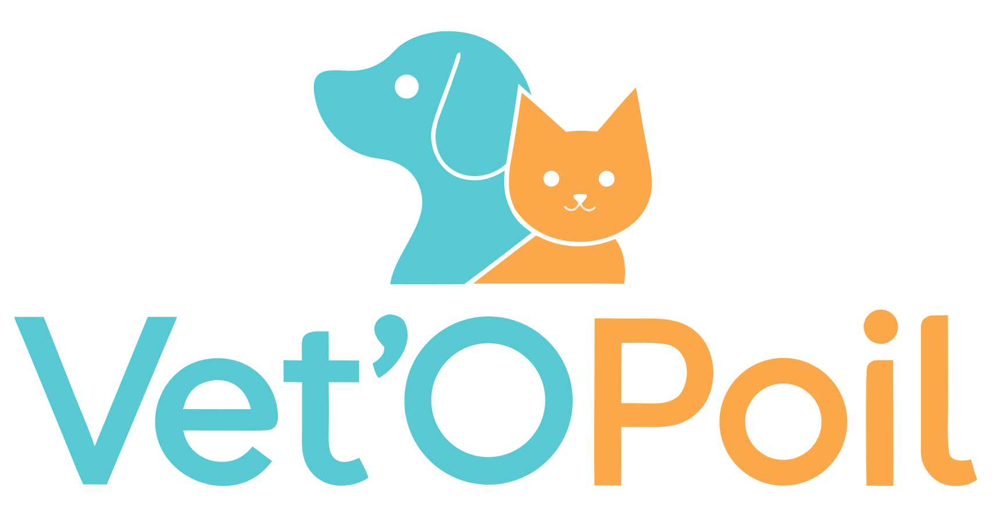
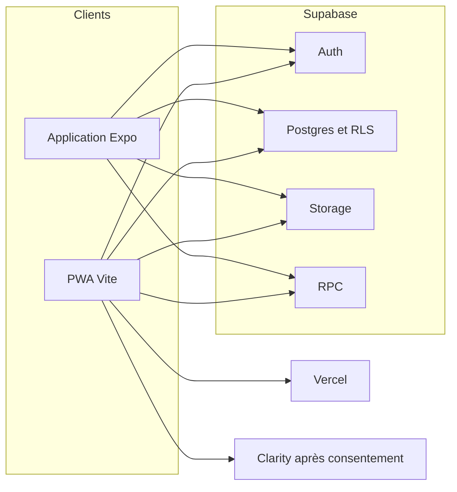

<p align="center">
  
</p>

<h1 align="center">Vet'OPoil</h1>

<p align="center">
  Carnet de santé numérique de l’animal.<br />
  Le propriétaire garde l’historique. Le vétérinaire ouvre le dossier le temps de la consultation.
</p>

<p align="center">
  <a href="https://veto-poils.vercel.app">veto-poils.vercel.app</a>
</p>

## Le produit

Vet'OPoil relie le propriétaire et la clinique autour d’un seul dossier : identité de l’animal, événements médicaux, documents, rappels, budget et partage. Le propriétaire reste maître des données. Chaque ajout fait depuis un accès vétérinaire attend sa validation.

Le site public présente le concept. L’espace propriétaire et le portail clinique sont la même application web, installable (PWA). L’application mobile reprend le parcours propriétaire sur iOS et Android. Les deux clients parlent au même projet Supabase.

## Équipe PIE

| Personne | Rôle |
| --- | --- |
| Taylor et Mariama | Gestion de projet, RGPD |
| Melvyn | Full-stack |
| Lucas | Mobile, design |
| Fiona | Authentification, front |

Les pages `/cgu` et `/confidentialite` décrivent le cadre du service. Elles ne remplacent pas une relecture juridique : le traitement des données de santé animale et des comptes reste à valider avec Taylor et Mariama.

## Fonctions

- **Smart Scan.** Import d’une photo ou d’un PDF, proposition de catégorie, lecture optionnelle du document, création d’un événement ou d’une dépense.
- **Accès vétérinaire.** Code à 6 caractères et QR, valable 4 heures, à usage limité, révocable. Le dossier se referme ensuite.
- **Health Score.** Score de 0 à 100, enregistré sur l’animal et dans un historique.
- **Rappels.** Vaccin, antiparasitaire, rendez-vous. Préférence de notification sur mobile.
- **Partage.** Invitation par e-mail en lecture seule ou en contribution (journal de pet-sitting).
- **Journal.** Repas, sorties, comportement, notes.
- **Budget.** Dépenses par catégorie, graphiques, export CSV.
- **PDF.** Dossier imprimable ou partageable.
- **Partenaires.** Suggestions selon l’espèce et la race, suivi des clics.
- **RGPD.** Export des données du compte et suppression du compte.
- **Portail vétérinaire.** Accès par code, patients déjà consultés, saisie d’un événement, compte clinique (nom, clinique, téléphone, numéro d’ordre).
- **PWA.** Manifeste, icônes et service worker émis au build du site.

Stripe, les abonnements et la téléconsultation ne font pas partie du produit.

## Architecture



Le site est servi par Vercel. L’authentification, les données, les fichiers et les fonctions SQL sont sur Supabase, projet `lmdszelnnibexzvnaubp` (région `eu-west-3`). Il n’y a pas de backend Symfony.

## Dépôt

```text
.
├── Version-Mobile/          application propriétaire Expo
├── version-web/             site, espace propriétaire et portail clinique
├── supabase/
│   ├── migrations/          schéma incrémental, dans l’ordre des horodatages
│   ├── bootstrap_all.sql    photographie historique du schéma
│   ├── seed.sql             données d’exemple
│   └── README.md
└── README.md
```

Les correctifs SQL historiques (`supabase/fix_*.sql`) sont repris dans `migrations/`. La source à appliquer est `supabase/migrations/`.

## Pile

Versions déclarées dans les `package.json`. Le caret ou le tilde est celui du fichier.

### Web — `version-web`

| Outil | Version déclarée |
| --- | --- |
| React | ^19.2.7 |
| React DOM | ^19.2.7 |
| React Router | ^7.18.1 |
| Vite | ^8.1.1 |
| @vitejs/plugin-react | ^6.0.3 |
| Tailwind CSS | ^4.3.2 |
| @tailwindcss/vite | ^4.3.2 |
| GSAP | ^3.15.1 |
| @gsap/react | ^2.1.2 |
| @supabase/supabase-js | ^2.110.0 |
| qrcode | ^1.5.4 |
| TypeScript | ~6.0.2 |
| ESLint | ^10.6.0 |
| typescript-eslint | ^8.62.0 |
| eslint-plugin-react-hooks | ^7.1.1 |
| eslint-plugin-react-refresh | ^0.5.3 |
| Vitest | ^3.2.4 |
| Playwright | ^1.65.0 |

### Mobile — `Version-Mobile`

| Outil | Version déclarée |
| --- | --- |
| Expo | ~57.0.22 |
| Expo Router | ~57.0.21 |
| React | 19.2.3 |
| React DOM | 19.2.3 |
| React Native | 0.86.3 |
| @supabase/supabase-js | ^2.110.0 |
| react-native-qrcode-svg | ^6.3.21 |
| react-native-svg | 15.15.4 |
| @react-native-async-storage/async-storage | 2.2.0 |
| TypeScript | ~6.0.3 |

Modules Expo utilisés : `expo-image-picker` ~57.0.17, `expo-document-picker` ~57.0.2, `expo-file-system` ~57.0.7, `expo-print` ~57.0.2, `expo-notifications` ~57.0.18, `expo-secure-store` ~57.0.4, `expo-sharing` ~57.0.19, `expo-image` ~57.0.5, `expo-linking` ~57.0.10.

### Backend et hébergement

| Brique | Rôle |
| --- | --- |
| Supabase Auth | Comptes propriétaire et vétérinaire, liens e-mail, PKCE |
| Postgres | Données du dossier, politiques RLS |
| Storage | Buckets privés `animal-photos` et `animal-documents` |
| Vercel | Build et hébergement de `version-web` |

## Bibliothèques

| Bibliothèque | Usage |
| --- | --- |
| React et React DOM | Interfaces web et mobile |
| React Router | Routes du site |
| Expo Router | Routes de l’application |
| Vite | Dev, build et PWA du site |
| Tailwind CSS | Styles du site |
| GSAP et @gsap/react | Animations du site. Elles respectent `prefers-reduced-motion` |
| @supabase/supabase-js | Auth, requêtes, fichiers et RPC, sur le web et le mobile |
| qrcode | QR du code vétérinaire sur le web |
| react-native-qrcode-svg | QR sur mobile |
| expo-image-picker, expo-document-picker | Photo et PDF pour Smart Scan |
| expo-print, expo-sharing | PDF du dossier sur mobile |
| expo-notifications | Rappels locaux |
| expo-secure-store | Session sur l’appareil |
| Vitest | Tests unitaires du site |
| Playwright | Parcours navigateur du site |
| ESLint et TypeScript | Contrôle statique |

## Modèle de données

Tables principales :

| Table | Contenu |
| --- | --- |
| `profiles` | Compte propriétaire |
| `vet_profiles` | Compte clinique, téléphone, numéro d’ordre |
| `animaux` | Fiche, score, archivage (`deleted_at`) |
| `medical_events` | Consultation, vaccin, chirurgie, ordonnance, analyse. Statuts validé, en attente, refusé |
| `documents` | Fichier, catégorie, lien éventuel vers un événement |
| `vet_access_tokens` | Code à 6 caractères, expiration, révocation |
| `animal_shares` | Invitation, lecture seule ou contribution |
| `reminders` | Échéances |
| `daily_logs` | Journal |
| `expenses` | Dépenses |
| `health_score_history` | Historique du score |
| `notifications` | Messages in-app, dont une saisie vétérinaire à valider |
| `partners`, `partner_clicks` | Annuaire et clics |

RPC principales :

| Fonction | Rôle |
| --- | --- |
| `ensure_owner_profile`, `handle_new_user` | Création du profil à l’inscription |
| `creer_animal`, `modifier_animal`, `archiver_animal` | Cycle de vie de la fiche |
| `generer_vet_token`, `valider_vet_token`, `revoquer_vet_token` | Accès de 4 heures |
| `vet_get_dossier`, `vet_create_medical_event` | Lecture et saisie avec le code |
| `vet_create_animal_medical_event` | Saisie ultérieure sur un animal déjà consulté |
| `valider_medical_event`, `refuser_medical_event` | Décision du propriétaire |
| `enregistrer_health_score` | Persistance du score |
| `inviter_partage_animal`, `accepter_invitation_partage`, `refuser_invitation_partage`, `revoquer_partage` | Partage |
| `increment_ocr_usage` | Compteur Smart Scan |
| `exporter_mes_donnees`, `supprimer_mon_compte` | Export et suppression |

## Sécurité

Postgres applique le RLS sur les tables du dossier. Les politiques s’appuient sur le rôle de l’utilisateur connecté.

- **Propriétaire.** Lit et écrit ses animaux, documents, dépenses, rappels et partages.
- **Contributeur.** Tient le journal. Il ne gère pas le partage ni la fiche médicale complète.
- **Lecture seule.** Consulte le dossier partagé.
- **Vétérinaire.** Profil distinct (`vet_profiles`). Le code ouvre un dossier limité dans le temps. Une saisie faite avec ce code reste en attente de validation. Un animal déjà consulté peut être rouvert depuis le compte clinique.
- **Anonyme.** Peut présenter un code encore valable. Sans code, pas d’accès au dossier.

Les fonctions sensibles sont `SECURITY DEFINER` et vérifient `auth.uid()` ou le code. Les buckets sont privés : le chemin de fichier est préfixé par le propriétaire. Les clients n’utilisent que la clé publique. La clé `service_role` ne va ni dans le dépôt, ni dans les variables `VITE_` ou `EXPO_PUBLIC_`.

Les liens d’e-mail (`/auth/callback`, `/reinitialiser-mot-de-passe`) doivent être autorisés dans Auth pour `https://veto-poils.vercel.app/**` et les aperçus `https://*.vercel.app/**`. Le lien se termine dans le même navigateur (PKCE).

## Variables d’environnement

Noms seulement. Les exemples vides sont dans `version-web/.env.example` et `Version-Mobile/.env.example`. Ne jamais committer de secret.

| Nom | Client | Rôle |
| --- | --- | --- |
| `VITE_SUPABASE_URL` | Web | URL du projet |
| `VITE_SUPABASE_ANON_KEY` | Web | Clé publique |
| `VITE_OCR_API_URL` | Web | Point d’entrée Smart Scan, optionnel |
| `VITE_OCR_API_KEY` | Web | Clé de cet appel, optionnelle |
| `VITE_CLARITY_PROJECT_ID` | Web | Mesure d’audience, optionnelle |
| `EXPO_PUBLIC_SUPABASE_URL` | Mobile | Équivalent de l’URL |
| `EXPO_PUBLIC_SUPABASE_PUBLISHABLE_KEY` | Mobile | Équivalent de la clé publique |
| `EXPO_PUBLIC_OCR_API_URL` | Mobile | Équivalent Smart Scan |
| `EXPO_PUBLIC_OCR_API_KEY` | Mobile | Équivalent de la clé Smart Scan |
| `EXPO_PUBLIC_VET_WEB_URL` | Mobile | Origine encodée dans le QR |

Le site accepte aussi les alias `NEXT_PUBLIC_SUPABASE_URL` et `NEXT_PUBLIC_SUPABASE_PUBLISHABLE_KEY`. Sans URL ni clé OCR, l’import reste possible et la catégorie est proposée à partir du nom de fichier. Le contrat d’appel est un `POST` JSON `{ image_base64, mime_type, file_name }`.

## Installation

Prérequis : Node.js, npm, et un projet Supabase dont les migrations ont été appliquées.

Site :

```bash
cd version-web
cp .env.example .env.local
npm install
npm run dev
```

Le site écoute sur `http://localhost:5173`.

| Commande | Effet |
| --- | --- |
| `npm run dev` | Vite |
| `npm run lint` | ESLint |
| `npm run build` | `tsc -b` puis build de production |
| `npm run preview` | Sert le build |
| `npm test` | Vitest, une fois |
| `npm run test:watch` | Vitest en veille |
| `npm run test:e2e` | Playwright |
| `npm run seed` | Jeu de données d’exemple, hors des secrets du dépôt |

Application :

```bash
cd Version-Mobile
cp .env.example .env
npm install
npm run typecheck
npm run start
```

`npm run android`, `npm run ios` et `npm run web` lancent la cible correspondante. Expo Go suffit pour un essai sur téléphone.

## Tests

- **Unitaires.** `version-web` : `npm test` (Vitest).
- **Parcours.** `version-web` : `npm run test:e2e`. Playwright ouvre Chromium sur `http://127.0.0.1:4173` (le script de config réutilise un serveur déjà lancé, sinon il démarre Vite). Le parcours couvre la page d’accueil, l’inscription, la connexion, une fiche et un code vétérinaire, contre le projet Supabase réel.
- **Mobile.** `npm run typecheck` dans `Version-Mobile`.

## Déploiement

Le projet Vercel pointe sur le dossier `version-web`. `vercel.json` lance `npm run build`, publie `dist/` et renvoie toutes les routes vers `index.html`. Le manifeste et le service worker sont produits au build.

Les migrations s’appliquent dans l’ordre des noms de fichiers de `supabase/migrations/`, via l’éditeur SQL du projet. Un fichier déjà passé est en général réentrant (`IF NOT EXISTS`, `CREATE OR REPLACE`). `ALTER TYPE ... ADD VALUE` reste seul dans sa migration : la valeur nouvelle ne s’utilise pas dans la même transaction.

## Mesure d’audience

Clarity n’est chargé que si `VITE_CLARITY_PROJECT_ID` est défini **et** que la personne a accepté la mesure. Le refus n’injecte pas le script. Le choix est mémorisé dans le navigateur.

## Suite

Le paiement, Stripe et les quotas liés à un abonnement sont hors périmètre. Le contrôle de quota animal ne bloque plus la création de fiche. Les certificats de notification de production (APNs, FCM) ne sont pas livrés : les rappels mobiles restent locaux.

## Licence et crédits

Aucun fichier `LICENSE` n’accompagne le dépôt : rien n’est placé sous une licence ouverte. Les dépendances restent sous la licence de leurs auteurs.

Marque et logo Vet'OPoil (chien et chat) : fichiers `version-web/src/assets/logo-full.svg` et `version-web/src/assets/logo-mark.svg`.

Projet mené par l’équipe PIE : Taylor, Mariama, Melvyn, Lucas et Fiona.
